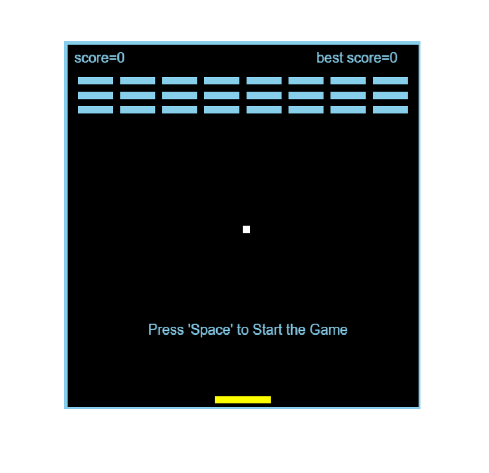
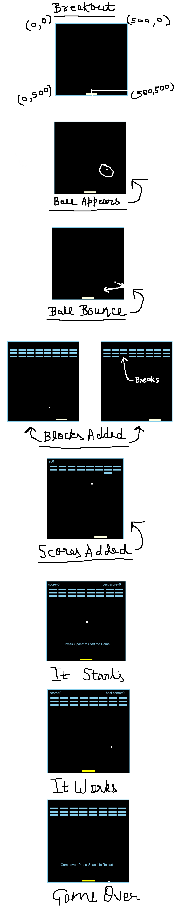

# MINI BREAKOUT

## WHAT IT IS?
class breakout game made with canvas5 and javascript, wihtout any libraries. made under 3kb for shrink ysws!!

## HOW TO PLAY
use Arrow Keys for movement. after breaking all the blocks you go to the Next Level with one extra row. each level increases the speed by 10 percent upto 100 percent i dont think anyone going that far tbh.

## HOW IS IT UNDER 3KB?
it runs without any server , it works on your browsers address bar, i uses a compliant minifying script which gets it under 3kb removing alot of the things and encoding it in such a way minimizing its size.

## WHY DID I MAKE THIS GAME?
i am new to making games, i made this in canvas5 and this game taught me collisions and how to work with them, it was a real mess working with collisions for this game. i had to change it a few times to get it right, the current code remembers where the ball was last frame and determines which side the ball came from, i added two variables that store balls position from the previous frame, then each top left right bottom functions check if its colliding and they check which side it came from different for each top bottom left right. if the ball came from top or bottom velocity y flips, if it came from left or right velocity x flips, the blocks are marked broken and 100 points are added to the score. there was one more bug which made the ball stutter in the wall because it was registering the ball to be touching the wall and was flipping it back continously making it look stuttered, which i fixed by setting the balls direction away from the wall using math abs so it cant flip twice. similar stutter problem was with the paddle so i made the ball get placed exactly on top of the paddle so it cant bounce again on the next frame.

## IT WAS FUN MAKING THIS GAME, HERE ARE SOME SCREENSHOTS:-

